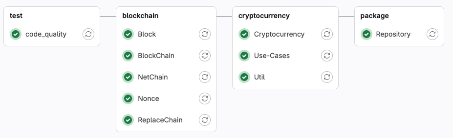

## JBlock | POC Java Blockchain

The project aims to prove the availability of an internal Java Blockchain able to store and maintain a chain of objects

from a basic concept in
src/doc/concept

# Mavem repository
https://gitlab.com/cleberlecheta/java-blockchain/-/packages